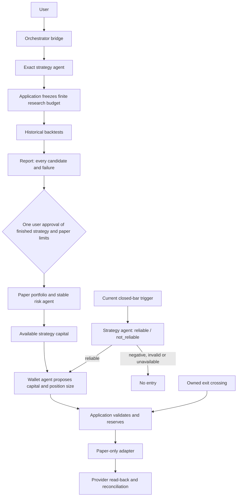

# Agent workflow

## Approval and authority

### Portfolio roles

| Portfolio | Role | Current availability |
| --- | --- | --- |
| Alpaca paper | Simulated execution for development and validation | Paper workflow implemented; real-provider acceptance remains pending |
| Liquid live perpetuals | Future real-money perpetual trading | Planned and inactive; current connection is read-only |
| FTMO two-step Swing | Evaluation portfolio via MT5 or a verified equivalent | Planned and inactive; bridge/account/rules verification remains pending |

Alpaca live is deferred. `/portfolios` displays these roles; planned identities do not represent
connected accounts or active risk agents. Historical Liquid paper state remains readable through
the retained journal services, outside the active setup, and cannot become live authority.

Research runs automatically under application limits. The user approves a **finished strategy once**,
including its exact evidence, implementation, paper account, instrument, sizing policy and wallet
limits. That approval permits automatic paper orders within those limits; individual signals do
not prompt for approval. Models cannot approve research, approve deployment or submit orders.
Live trading and FTMO execution remain unavailable.

## Automatic research

The active TUI uses `workflow/runtime.py`. `/create <brief>` and explicit natural-language research
requests produce typed Yahoo SMA candidates, stable exact owners, duplicate reuse and variant
lineage. The supported family is long-only SMA crossover; other strategy families remain unsupported.
Models cannot substitute SMA for a requested different strategy or execute imported code.

New `agent-research-plan/2` campaigns freeze at most twelve candidates and twenty-four native starts,
two per eligible dataset (base/stress). Application policy authorizes these starts without a human
prompt. Receipts explicitly say `human_approval=false` and `order_authority=false`; native candidate
receipts pin the parent campaign. There is no recursive optimization loop or automatic retry of
consumed starts. Blocked datasets, failed/canceled/interrupted attempts and exact ownership survive.

`/flow` lists campaigns; `/flow-show <id>` verifies their plans/reports. `/flow-cancel <id>` or Ctrl+K
cancels work without replay. Tests and Reports show campaign rows. Specialists receive only their
own verified candidate evidence. No automatic global-best or independent-holdout claim is made.

Historical `agent-research-plan/1` campaigns retain their original approval contract and
`/flow-approve` compatibility path. Explicit `/yahoo`, `/new` and `/study` commands retain their
historical manual protocols. Their saved approvals are never relabeled as the new policy.

## Final strategy and paper use

1. Finish a successful research campaign and inspect its full report.
2. Run `/alpaca-paper-connect`. Enter **paper** keys in the masked form; they use native OS secure
   storage. Connection checks the fixed paper endpoint and binds the exact returned account.
   Connection alone grants no strategy authority.
3. Run `/strategy-finish <campaign-id> <strategy-id-or-candidate-job-id> alpaca`. Use a job ID when
   multiple windows share the same exact strategy identity. Four optional decimal fractions specify
   strategy capital, position capital, full-loss risk and daily loss, in that order. Defaults are
   0.25, 0.05, 0.01 and 0.02. All assigned strategies share the same wallet policy.
4. Review the final package: exact selected evidence, all-attempt reference, implementation, symbol,
   account, behavior, limits and limitations. Approve with its button or
   `/strategy-approve <package-id> <sha256>`. This is the only new-workflow human approval.
   `/strategy-show <package-id>` reopens it; rejection grants no authority.
5. The paper runner warms up and monitors while the TUI is open. `/portfolio-stop` stops it and
   keeps positions. `/portfolio-run alpaca` explicitly restarts an approved runner; it does not
   approve anything. Saved approvals do not start trading automatically on application launch.

Only identical base/USD **crypto spot** mappings are executable initially, for example Yahoo
`BTC-USD` to Alpaca `BTC/USD`. The signal kernel uses exact rational SMA crossings and continuous
closed hourly/daily bars. Warmup emits no historical order. Missing/revised bars, gaps after a stop,
stale quotes/signals or an inconsistent account stop processing rather than backfilling trades.

The versioned `cash_long_bounded_quantity_ioc/1` execution policy is separate from the historical
fixed-quantity simulation. The wallet agent can reduce size below the tested quantity; it cannot
exceed it. This changes returns and must never inherit the backtest performance label. The policy
has no leverage, shorts, reinforcement or stop orders. The **entire reserved entry capital counts
as risk**, including an explicit fee buffer. Opposite crossings exit the reconciled owned quantity
without an LLM. Price-bounded IOC orders can fill partially or not fill; an exit is not guaranteed.
These limits and differences are displayed before approval.

Each buy trigger has at most three structured model calls: binary specialist review, wallet capital
allocation and position capital. Literal evidence references, exact owner/snapshot pins and current
account limits are checked by application code. The separate advisory preview API remains a preview;
its `execution_authorized=false` result is not an order receipt.

## Account state and recovery

`/portfolios` shows the current roles above, separate identities and stable risk-agent IDs.
`/portfolio-orders` shows retained order outcomes. The Positions panel shows the runner's reconciled
quantities, strategy capital and committed reservations. The legacy `/paper` view remains an authored
fixture journal with its own labels and evidence rules.

A native-state SQLite journal outside the research-root override coordinates the personal paper
account across project directories. One OS account lease covers inference and dispatch; SQLite
transactions persist consumed signals, approvals, review receipts and order intents. One instrument
has one assigned owner, avoiding ambiguous attribution of a provider's netted position. Pending
orders and occupied capital lock the corresponding strategy allocation.

The application writes a reservation/client order ID before POST. A timeout/cancellation is uncertain,
not permission to retry. Read back that same ID; even a subsequent 404 does not authorize a second
submission. Partial fills retain reservations; confirmed terminal orders and provider positions must
agree before further entries. Keep changed confirmations and conflicting exposure evidence. Unknown
orders, external/late positions, mismatched accounts and observed loss limits halt entries.
No inferred fill notional or fee is labeled as actual broker economics.

Automatic halt clearing, safe stream rewarming after a gap, approval retirement/upgrades, emergency
close-all and full keep/close-on-quit controls remain unfinished. `/portfolio-stop` and quitting keep
positions and stop monitoring. Changing/forgetting the model also stops the runner. Do not advertise
unattended or release-ready operation before these acceptance cases are complete.

## Liquid and FTMO boundaries

Liquid targets live perpetuals. Its current implementation remains read-only diagnostics; there is
no live feed/order transport or activation. Trading needs a separately verified capability, exact
live account, appropriate authorization, perpetual-specific research and operational acceptance.
Read-only OAuth is never upgraded or reused as trade permission. Yahoo spot results cannot establish
margin/funding/liquidation behavior. The former Liquid paper identity and fail-closed adapter remain
historical compatibility only; their journals/packages never become live approvals.

FTMO targets the two-step Swing evaluation through MT5 or a verified equivalent. No bridge is
implemented. Verify the actual platform, account/phase, instrument specifications, fees/swaps,
dated loss/reset rules and bridge deployment on the supported OSes before implementation/activation.
Evaluation is a separate environment, not an Alpaca paper or Liquid live account.

Alpaca transport uses only the fixed [paper endpoint](https://docs.alpaca.markets/us/docs/paper-trading),
[order API](https://docs.alpaca.markets/us/reference/postorder) and
[client-ID read-back](https://docs.alpaca.markets/us/reference/getorderbyclientorderid).
Crypto bars/quotes use Alpaca's data host. Actual account/feed access and sustained paper execution
have not been verified by fixture tests. No paid feed, account purchase, live order or FTMO challenge
activation is authorized here.
