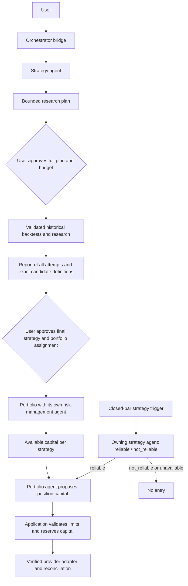

# Agent workflow

## Target lifecycle

The orchestrator is the user's bridge. Strategy reasoning belongs to one stable specialist per
exact strategy; wallet reasoning belongs to one separate risk agent per portfolio. Agents use
configured model providers with isolated contexts, not separately trained models.

Research approval and final strategy approval are different decisions. A research report is not
an order mandate. A binary model verdict is advisory and cannot override deterministic gates.
Protective exits and emergency controls must not depend on a model's availability.

## Implemented replacement: research handoff

The TUI uses `workflow/runtime.py`. Its narrow route delegates or creates a reviewed research
campaign; the retired natural-language action router and January-2025 creation flow are no longer
the active chat workflow. Existing services and historical agent modules remain compatibility
helpers for explicit legacy commands, identities, reports and tests. Do not delete retained data
or change old evidence to make it look like the new workflow.

`/create <brief>` sends the brief to a typed research planner. The application currently compiles
only supported long-only SMA crossover definitions. Proposals can compare up to twelve explicit
Yahoo requests across supported assets, intervals, periods, windows and costs. Other strategy
families need their own implementation and conformance tests; a model cannot substitute SMA for
them. Hourly/daily acquisition and dataset gates remain those of the [Yahoo guide](yahoo-backtesting.md).

The application registers exact definitions, reuses duplicate strategy agents, and records lineage
for new variants. Each candidate's snapshot, definition, implementation and two native starts are
pinned. Dataset failures remain visible and consume no native starts. One human approval binds
the complete campaign and every eligible candidate. The application derives individual native
approvals from that retained human decision; models have no approval operation.

Use `/flow` to list campaigns, `/flow-show <id>` to review them, and
`/flow-approve <id> <sha256>` to execute the exact finite plan. An inline approval button uses the
same service. `/flow-cancel <id>` cancels pending/running work. Restart never resumes consumed
starts. Legacy `/new`, `/study`, `/show`, `/report` and source commands remain explicit compatibility
operations; the new bridge does not silently route requests into them.

Tests and Reports include campaign rows. The report retains all completed, failed and acquisition-
blocked attempts, each attributed to its exact definition. Specialist chat receives only its own
verified candidate reports. The report does not select a winner, claim an independent holdout,
promote a strategy or assign it to an account. Cross-market raw returns cannot establish a global
"best asset" when position sizing, windows, currencies or market semantics differ.

## Advisory portfolio contracts and validation

`workflow/contracts.py` describes portfolio identity/mode/limits, minimal risk snapshots, binary
strategy verdicts and capital proposals. `workflow/risk.py` provides isolated structured model
calls plus deterministic checks for exact ownership, current/reconciled snapshots, assigned-only
capital, aggregate equity, per-strategy caps, locked committed capital, available cash, position
caps, nominal stop risk and quantity increments.

These are advisory/preview services, not a connected portfolio lifecycle. They do not persist an
approved allocation, reserve funds, submit orders or attest provider state. A position preview
always has `execution_authorized=false`. Snapshots used in tests are authored fixtures. A model
verdict of "reliable" does not demonstrate actual probability of success.

Before connecting these services, implement and test the following boundaries:

1. A final strategy package binds the exact implementation, instrument mapping, entry/exit/sizing
   rules, research evidence, limitations and supported account environment. Human approval of its
   digest precedes assignment. Backtest definitions are not silently rewritten by portfolio sizing.
2. Each portfolio has a stable risk-agent context, explicit user risk policy and a provider account
   binding. Strategies share an authoritative account-wide ledger for exposure, positions and
   reservations; duplicate logical portfolios cannot double-spend the same account.
3. Strategy capital is a ceiling. Capital already committed or reserved remains claimed until
   reconciled terminal evidence. Models cannot replenish budgets or discard failed attempts.
4. A closed-bar trigger binds the exact deployed strategy, instrument, observation and finite
   freshness. Its own specialist returns reliable/not_reliable with application-owned evidence.
   Unavailable, malformed, stale or mismatched reviews deny new entries.
5. For a reliable entry, the portfolio agent proposes position capital. Application code validates
   current policy, account state, nominal/gap risk, correlation/concentration, open and pending
   exposure, provider increments, fees and daily/drawdown limits before an atomic reservation.
6. An idempotent adapter submits only an approved reserved intent. Acknowledgments, partial fills,
   cancellations, ambiguous outcomes, restart and shutdown are reconciled against retained evidence.
   No model has generic broker, credential, SQL, shell or imported-code capabilities.

## Connector scope

The user has explicitly reopened Alpaca alongside Liquid and requested an FTMO two-step Swing
route. Separate adapter/environment identities are required for Alpaca paper/live, Liquid
paper/live and FTMO evaluation. These are planned connections; only the prior Liquid read-only
diagnostics currently exist. No account is connected or activated by declaring a portfolio.
Live transport needs separate activation after verification. Do not purchase a challenge or
change provider scopes as part of architecture work.

FTMO two-step Swing is a platform-backed evaluation route, not an assumed generic broker REST API.
Bind its actual platform/account and versioned rules. Verify loss calculations, timezone resets,
challenge phase and contract sizes using the user's actual account configuration. The official
[2-Step page](https://ftmo.com/en/2-step-challenge/) describes the evaluation and Swing holding/news
policies. Alpaca documents separate paper credentials and endpoint in its
[authentication guide](https://docs.alpaca.markets/us/v1.1/docs/authentication-1).

## Remaining work

Final strategy packaging/approval/assignment, persisted portfolio state and model review receipts,
verified feeds and providers, automated recurring research, regime/trend analysis, true holdout
selection, operational signal review and execution are unfinished. No phase or release is complete
because the replacement research handoff or advisory fixtures pass.
