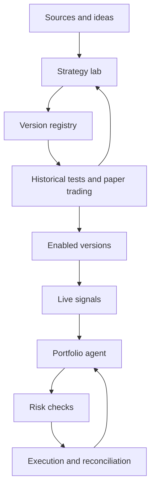

# Architecture and agents

## Proposed structure

Separate the research plane from the operational plane. Agents reason, propose changes, and use tools with defined contracts; deterministic services manage data, simulations, risk limits, and order submission.

Promotion to an enabled version requires validation evidence and, for live execution, explicit user activation.

## Agent roles

| Role | Responsibility | Output |
| --- | --- | --- |
| Orchestrator | Plan work, assign tools, and respect budgets and dependencies | Workflow state and step log |
| Source analyst | Extract rules and distinguish claims, evidence, and missing information | Source record and draft specification |
| Quant researcher | Formalize logic, assumptions, indicators, and variants | Versioned strategy specification |
| Developer | Translate the specification into code and verify its alignment | Implementation and rule checks |
| Validator | Configure experiments and assess robustness and limitations | Report, issues, and promotion proposal |
| Portfolio agent | Coordinate allocations, signals, and position openings/closures | Allocation proposal and position intents |
| Operational supervisor | Inspect anomalies, drift, and service health | Alerts and pause or review proposals |

These are logical roles: they do not imply seven continuously running processes or models. Orchestration may reuse models and invoke agents when the workflow requires them.

## Application components

- **Source connectors:** retrieve authorized content, transcripts, images, and accessible code.
- **Data service:** normalize historical data and live feeds, metadata, and quality.
- **Strategy registry:** store specifications, code, dependencies, versions, and states.
- **Isolated runner:** execute generated code with limited resources and access.
- **Testing engine:** provide simulation, replay, evaluation, and reproducible reports.
- **Strategy runtime:** compute signals from immutable versions.
- **Portfolio and risk management:** manage proposed allocations, binding checks, and aggregate state.
- **Execution gateway:** provide broker/exchange adapters, orders, and reconciliation.
- **Storage and observability:** retain evidence, experiments, events, metrics, and audit records.

## Core contracts

| Object | Minimum information |
| --- | --- |
| SourceArtifact | URL/origin, author if known, acquisition date, available content, hash, and usage permissions |
| StrategySpec | Rules, parameters, instruments, timeframe, assumptions, and source references |
| StrategyVersion | Specification, code, dependencies, parent, hash, and state |
| ExperimentRun | Version, dataset, protocol, costs, seed where relevant, results, and logs |
| Signal | Strategy/version, instrument, timestamp, validity, action or desired exposure, and rationale |
| PortfolioProposal | Reference state, allocations, position intents, and rationale |
| OrderIntent | Account, instrument, side, quantity, type, limits, versions, and idempotency identifier |
| ExecutionEvent | Order, state, fill, quantity, price, costs, and timestamp |

A textual recommendation is not an order. Every proposal passes through structural validation, risk checks, and an operational adapter.

## Runtime properties

Persist job checkpoints, support cancellation and resumption, deduplicate events, and make timeouts and retries explicit. The live runtime must not wait for new code generation. If an agent is unavailable, it applies a predefined policy for new signals and existing positions; reconciliation continues independently of agents.

The language, agent framework, database, queue, and backtesting engine will be selected through compatibility checks. This structure defines responsibilities and contracts without prematurely fixing the technology stack.
