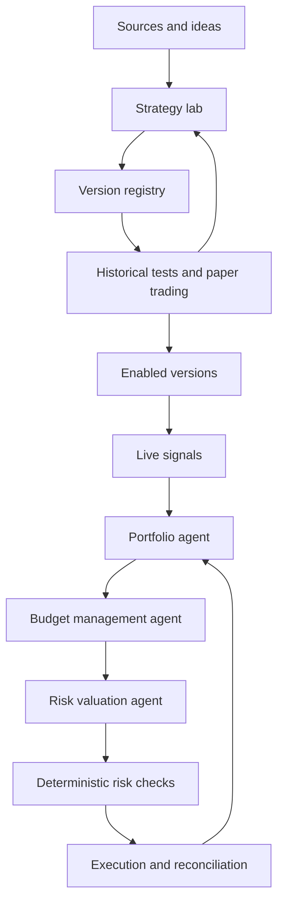

# Architecture and agents

## Selected foundation

**Confirmed:** Python for the backend, LangGraph for agent orchestration, Supabase-managed PostgreSQL for the registry and related records, Supabase Auth with OAuth login, and NautilusTrader for backtesting and execution. Alpaca and Liquid are optional operational connectors, not login requirements. [Phase 0](phase0.md) pins Python 3.14.7/NautilusTrader 1.231.0 and verifies a bounded native simulation on Linux x86_64/ARM64 and macOS 26 ARM64. Intel macOS uses a verified custom wheel because no pinned published wheel is available; see [Intel verification](intel-macos.md). The Phase 0 proof alone does not implement a research application or live adapter. The subsequent [Phase 2 increment](phase2.md) implements one reviewed local research workflow; live adapters remain unavailable.

**Selected in Phase 0:** Pydantic contracts, Textual TUI framework and a hosted HTTPS/JSON application API boundary for the shared catalog. Contract/framework proofs and the [first Phase 1 terminal/model-chat increment](phase1.md) exist. **Still proposed:** Parquet, DuckDB, isolated research-worker implementation and the hosted API framework/hosting. FastAPI remains optional, not a requirement for a web interface.

## Proposed structure

Separate the research plane from the operational plane. Agents reason, propose changes, and use tools with defined contracts; deterministic services manage data, simulations, risk limits, and order submission.

Promotion to an enabled version requires validation evidence and, for live execution, explicit user activation.

## Agent roles

| Role | Responsibility | Output |
| --- | --- | --- |
| Chief agent / orchestrator | Maintain the user-facing chat, plan work, process interventions, assign tools, and respect budgets and dependencies | Workflow state, structured operations, explanations, and step log |
| Source analyst | Extract rules and distinguish claims, evidence, and missing information | Source record and draft specification |
| Quant researcher | Formalize logic, assumptions, indicators, and variants | Versioned strategy specification |
| Developer | Translate the specification into code and verify its alignment | Implementation and rule checks |
| Validator | Configure experiments and assess robustness and limitations | Report, issues, and promotion proposal |
| Portfolio coordinator | Coordinate signals, target exposures, and position openings/closures | Candidate position intents |
| Budget management agent | Propose capital allocations and sizing within the user's mandate | Budget/allocation proposal linked to account state |
| Risk valuation agent | Evaluate portfolio impact, concentration, liquidity, and downside assumptions | Structured risk assessment, objections, and revised intents |
| Operational supervisor | Inspect anomalies, drift, and service health | Alerts and pause or review proposals |

These are logical roles: they do not imply one continuously running process or model per role. Orchestration may reuse models and invoke agents when the workflow requires them.

## Terminal, research, and operational processes

The TUI is the permanent user interface. It connects to application operations rather than holding the authoritative job or trading state. Research jobs run separately from the trading runtime so a heavy backtest or agent failure does not block reconciliation and protection logic.

The chief agent uses LangGraph to coordinate extraction, specification, development, validation, and improvement. Persist workflow checkpoints, intervention events, job IDs, and evidence references. Slash commands invoke the same validated operations without requiring the model to interpret the command. Pausing research does not implicitly pause trading or close positions.

A hosted HTTPS/JSON [application API boundary](phase0-access-boundary.md) is selected for catalog access and PostgreSQL authorization. Supabase is selected for the managed database. Application-service framework/hosting, secure local session storage and online outage behavior remain open; offline functionality is excluded. Privileged database credentials must not reach terminal clients. A single repository with modular boundaries and separate worker processes remains the initial proposal.

## NautilusTrader's responsibility

The selected engine consumes historical or live market events, runs fixed strategy implementations, models or routes orders, and exposes execution/account state. Agents provide specifications, generated code, experiment requests, and portfolio proposals through application-owned contracts. The engine does not replace the chief agent, source analysis, registry, or recommendation system.

Validate the exact selected engine version, Python runtime, instrument types, providers, and adapters together. Use a stable, verified release before live capital. Add capability checks for session calendars, quantity increments, margin, shorting, and order types. Multi-market support does not mean every provider supports every instrument or feature.

Keep engine-specific APIs behind a stratosphere adapter. Alternative engines remain comparison context, not additional selected runtime dependencies. VectorBT is a possible later research accelerator; Quiver is an optional alternative-data connector, not a trading engine or a required universal price feed.

## Application components

- **Source connectors:** retrieve authorized content, transcripts, images, and accessible code.
- **Data service:** normalize historical data and live feeds, metadata, and quality.
- **Strategy registry:** shared Supabase-managed PostgreSQL identities, exact specifications, source associations, implementation versions, and catalog records.
- **Community recommendations:** compare evidence quality, risk, compatibility, and current user constraints.
- **Terminal operation layer:** validated chat/command actions, job control, events, and UI state.
- **Identity and account connections:** Supabase Auth session validation, application ownership, and separately authorized optional Alpaca/Liquid accounts.
- **Isolated runner:** execute generated code with limited resources and access.
- **Testing engine:** provide simulation, replay, evaluation, and reproducible reports.
- **Strategy runtime:** compute signals from immutable versions.
- **Portfolio and risk management:** coordinate budget management and risk valuation agents, then enforce deterministic checks against fresh aggregate state.
- **Execution gateway:** selected optional Alpaca/Liquid adapters, orders, and reconciliation behind the operational runtime; never independent agent-to-provider order paths.
- **Storage and observability:** retain evidence, experiments, events, metrics, and audit records.

## Core contracts

| Object | Minimum information |
| --- | --- |
| SourceArtifact | URL/origin, author if known, acquisition date, available content, hash, and usage permissions |
| StrategySpec | Rules, parameters, instruments, timeframe, assumptions, and source references |
| StrategyVersion | Strategy identity, implementation/code reference, dependencies, hash, and state; behavior changes require a new strategy identity |
| ExperimentRun | Version, dataset, protocol, costs, seed where relevant, results, and logs |
| Signal | Strategy/version, instrument, timestamp, validity, action or desired exposure, and rationale |
| PortfolioProposal | Reference state, allocations, position intents, and rationale |
| OrderIntent | Account, instrument, side, quantity, type, limits, versions, and idempotency identifier |
| ExecutionEvent | Order, state, fill, quantity, price, costs, and timestamp |

A textual recommendation is not an order. Every proposal passes through structural validation, risk checks, and an operational adapter.

## Runtime properties

Persist job checkpoints, support cancellation and resumption, deduplicate events, and make timeouts and retries explicit. The live runtime must not wait for new code generation. If an agent is unavailable, it applies a predefined policy for new signals and existing positions; reconciliation continues independently of agents.

Python, LangGraph, Supabase-managed PostgreSQL, Supabase Auth OAuth login, and NautilusTrader are selected; Alpaca and Liquid are optional operational connectors. Phase 0 selects runtime versions, Textual and the shared API transport. Queue technology, application hosting, production model coverage and exact trading adapters remain open. See the [decision log](decisions.md) and [database model](database-model.md).

## Supabase boundary

Supabase is the selected managed PostgreSQL platform; the logical tables and exact-strategy identity rules remain unchanged. Supabase Auth with OAuth login is now confirmed separately from the database decision. Storage, Realtime, Edge Functions, and a direct-client Data API design remain unselected.

Keep secret/service-role keys and privileged connection credentials out of the distributed TUI and generated-code runner. Exposed schemas require RLS and least-privilege grants, with distinct policies for shared catalog records and private user data. Application access paths, OAuth providers, terminal callback flow, session handling, and authorization policies must be specified and tested before enabling client access. See [authentication and connectors](authentication-and-connectors.md).

## Online experience and provider selection

Research, reporting and registration require online checks. The later explicit Ollama request permits local inference as a model-provider exception, without adding offline research or cached fallback. Client targets start with Linux/macOS and English UI, with eventual support for all OSes. Local credential storage, if selected, supports online authentication and is not an offline product mode. Research and trading run locally on users' computers. The user-facing TUI-exit decision is fixed: keep positions open or close them all. Lifecycle internals must implement that choice. Shared online auth/catalog/billing services are separate from local compute.

Users select models from multiple providers. Development/testing currently uses OpenRouter `cohere/north-mini-code:free`, selected through the [verified free-model comparison](phase1.md#working-free-text-model-selection). The [model-provider adapters](model-providers.md) include NVIDIA NIM and ten newly requested cloud/local choices; their exact protocol and live-verification boundaries are recorded separately. NVIDIA's prior live attempts and limitations are retained in Phase 1. The first Phase 2 structured extraction has live validation, while broader tool/schema equivalence across providers remains unverified. Isolate provider adapters from workflow contracts; do not claim equivalent capabilities without verification.

Commercial billing needs a deterministic private fee ledger linked to opening executions. The selected target is 0.5% per opening trade, capped at $1; fee basis/grouping/collection remain open. See [commercial requirements](commercial-model.md).

## Local runtime and TUI exit

The user chooses to keep positions or request closure of all positions when exiting the TUI. Do not add a third user-facing choice or reopen this decision. A separate local worker is an implementation option, subject to honoring the confirmed exit behavior. Stopping the worker or powering down ends runtime-managed exits and reconciliation; already-accepted venue-side protective orders only provide the protection actually supported by the provider. Lifecycle and protective-order behavior requires implementation and tests under the approved mandate.

Closure is a requested operation with tracked outcomes, not an assumed immediate fill. Define pending-entry cancellation, partial-fill reconciliation, residual exposure, failure notification and worker termination before shipping this exit flow.

## First implemented research worker

[Phase 2](phase2.md) implements source extraction/validation through LangGraph, a trusted canonical SMA compiler, exact-plan approval and a native NautilusTrader subprocess. The process receives only validated research inputs and a minimal credential-free environment; arbitrary generated code remains disabled. Private local artifacts retain the source, implementation snapshot, approved plan, data, native results, reports and event/checkpoint history. This local evidence store is not a replacement for the planned Supabase registry or an unauthenticated shared service.

New runs/resume fetch and verify the pinned BTC/USDT archive online; app inspection of retained plans/reports also checks connectivity. One approval covers the fixed base/doubled-cost pair; completed work survives pause/restart without rerunning completed checkpoints or another model call. Report metrics are deterministic and can be supplied to the conversation as evidence. The current development model remains the verified OpenRouter Cohere free selection in D44; NVIDIA is an explicit alternative.
