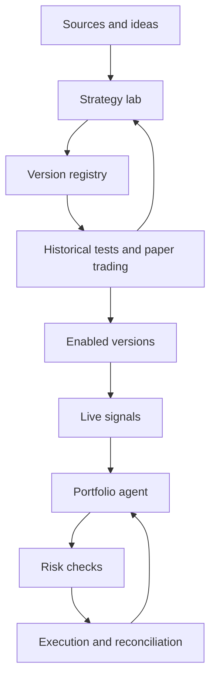

# Architecture and agents

## Selected foundation

**Confirmed:** Python for the backend, LangGraph for agent orchestration, PostgreSQL for the registry and related records, and NautilusTrader for backtesting and execution. NautilusTrader version and adapters must be verified before implementation and live use. No engine integration is implemented yet.

**Proposed supporting components:** Pydantic contracts, versioned Parquet data, DuckDB for analysis, isolated research workers, and a TUI framework to be selected. FastAPI is optional for a shared catalog service, not a requirement for a web interface. These supporting choices are not confirmed.

## Proposed structure

Separate the research plane from the operational plane. Agents reason, propose changes, and use tools with defined contracts; deterministic services manage data, simulations, risk limits, and order submission.

Promotion to an enabled version requires validation evidence and, for live execution, explicit user activation.

## Agent roles

| Role | Responsibility | Output |
| --- | --- | --- |
| Chief agent / orchestrator | Maintain the user-facing chat, plan work, process interventions, assign tools, and respect budgets and dependencies | Workflow state, structured operations, explanations, and step log |
| Source analyst | Extract rules and distinguish claims, evidence, and missing information | Source record and draft specification |
| Quant researcher | Formalize logic, assumptions, indicators, and variants | Versioned strategy specification |
| Developer | Translate the specification into code and verify its alignment | Implementation and rule checks |
| Validator | Configure experiments and assess robustness and limitations | Report, issues, and promotion proposal |
| Portfolio agent | Coordinate allocations, signals, and position openings/closures | Allocation proposal and position intents |
| Operational supervisor | Inspect anomalies, drift, and service health | Alerts and pause or review proposals |

These are logical roles: they do not imply seven continuously running processes or models. Orchestration may reuse models and invoke agents when the workflow requires them.

## Terminal, research, and operational processes

The TUI is the permanent user interface. It connects to application operations rather than holding the authoritative job or trading state. Research jobs run separately from the trading runtime so a heavy backtest or agent failure does not block reconciliation and protection logic.

The chief agent uses LangGraph to coordinate extraction, specification, development, validation, and improvement. Persist workflow checkpoints, intervention events, job IDs, and evidence references. Slash commands invoke the same validated operations without requiring the model to interpret the command. Pausing research does not implicitly pause trading or close positions.

A shared service boundary is proposed for catalog access and PostgreSQL authorization. Hosting, API transport, local persistence, and offline behavior require further decisions; do not expose database credentials to arbitrary clients. A single repository with modular boundaries and separate worker processes is the initial proposal, not a requirement to deploy many microservices.

## NautilusTrader's responsibility

The selected engine consumes historical or live market events, runs fixed strategy implementations, models or routes orders, and exposes execution/account state. Agents provide specifications, generated code, experiment requests, and portfolio proposals through application-owned contracts. The engine does not replace the chief agent, source analysis, registry, or recommendation system.

Validate the exact selected engine version, Python runtime, instrument types, providers, and adapters together. Use a stable, verified release before live capital. Add capability checks for session calendars, quantity increments, margin, shorting, and order types. Multi-market support does not mean every provider supports every instrument or feature.

Keep engine-specific APIs behind a stratosphere adapter. Alternative engines remain comparison context, not additional selected runtime dependencies. VectorBT is a possible later research accelerator; Quiver is an optional alternative-data connector, not a trading engine or a required universal price feed.

## Application components

- **Source connectors:** retrieve authorized content, transcripts, images, and accessible code.
- **Data service:** normalize historical data and live feeds, metadata, and quality.
- **Strategy registry:** shared PostgreSQL identities, exact specifications, source associations, implementation versions, and catalog records.
- **Community recommendations:** compare evidence quality, risk, compatibility, and current user constraints.
- **Terminal operation layer:** validated chat/command actions, job control, events, and UI state.
- **Isolated runner:** execute generated code with limited resources and access.
- **Testing engine:** provide simulation, replay, evaluation, and reproducible reports.
- **Strategy runtime:** compute signals from immutable versions.
- **Portfolio and risk management:** manage proposed allocations, binding checks, and aggregate state.
- **Execution gateway:** provide broker/exchange adapters, orders, and reconciliation.
- **Storage and observability:** retain evidence, experiments, events, metrics, and audit records.

## Core contracts

| Object | Minimum information |
| --- | --- |
| SourceArtifact | URL/origin, author if known, acquisition date, available content, hash, and usage permissions |
| StrategySpec | Rules, parameters, instruments, timeframe, assumptions, and source references |
| StrategyVersion | Strategy identity, implementation/code reference, dependencies, hash, and state; behavior changes require a new strategy identity |
| ExperimentRun | Version, dataset, protocol, costs, seed where relevant, results, and logs |
| Signal | Strategy/version, instrument, timestamp, validity, action or desired exposure, and rationale |
| PortfolioProposal | Reference state, allocations, position intents, and rationale |
| OrderIntent | Account, instrument, side, quantity, type, limits, versions, and idempotency identifier |
| ExecutionEvent | Order, state, fill, quantity, price, costs, and timestamp |

A textual recommendation is not an order. Every proposal passes through structural validation, risk checks, and an operational adapter.

## Runtime properties

Persist job checkpoints, support cancellation and resumption, deduplicate events, and make timeouts and retries explicit. The live runtime must not wait for new code generation. If an agent is unavailable, it applies a predefined policy for new signals and existing positions; reconciliation continues independently of agents.

Python, LangGraph, PostgreSQL, and NautilusTrader are selected. Queue technology, hosting, runtime versions, TUI library, model providers, and adapters remain open. See the [decision log](decisions.md) and [database model](database-model.md).
