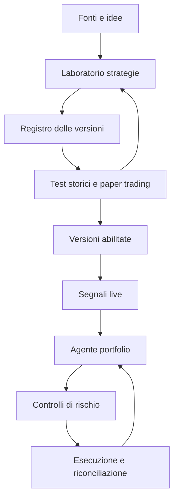

# Architettura e agenti

## Struttura proposta

Separare il piano di ricerca dal piano operativo. Gli agenti ragionano, propongono e usano strumenti con contratti definiti; servizi deterministici gestiscono dati, simulazioni, limiti di rischio e invio ordini.

La promozione a versione abilitata richiede evidenze di validazione e, per l'esecuzione reale, attivazione esplicita dell'utente.

## Ruoli degli agenti

| Ruolo | Responsabilità | Output |
| --- | --- | --- |
| Orchestratore | Pianificare il lavoro, assegnare strumenti, rispettare budget e dipendenze | Stato del workflow e registro dei passaggi |
| Analista delle fonti | Estrarre regole e distinguere affermazioni, evidenze e informazioni mancanti | Scheda fonte e bozza della specifica |
| Ricercatore quant | Formalizzare logica, ipotesi, indicatori e varianti | Specifica strategia versionata |
| Sviluppatore | Tradurre la specifica in codice e verificarne la corrispondenza | Implementazione e verifiche delle regole |
| Validatore | Configurare esperimenti e valutare robustezza e limiti | Report, criticità e proposta di promozione |
| Agente portfolio | Coordinare allocazioni, segnali e aperture/chiusure | Proposta di allocazione e intenti di posizione |
| Supervisore operativo | Leggere anomalie, deriva e stato dei servizi | Allarmi e proposte di pausa o revisione |

Questi sono ruoli logici: non implicano sette processi o modelli sempre attivi. L'orchestrazione potrà riutilizzare modelli e avviare agenti quando il workflow lo richiede.

## Componenti applicativi

- **Connettori fonti:** recupero dei contenuti autorizzati, trascrizioni, immagini e codice accessibile.
- **Servizio dati:** normalizzazione dello storico e dei feed live, metadati e qualità.
- **Registro strategie:** specifiche, codice, dipendenze, versioni e stati.
- **Runner isolato:** esecuzione del codice generato con risorse e accessi limitati.
- **Motore di test:** simulazione, replay, valutazione e report riproducibili.
- **Runtime strategie:** calcolo dei segnali da versioni immutabili.
- **Gestione portfolio e rischio:** allocazioni proposte, controlli vincolanti e stato aggregato.
- **Gateway esecuzione:** adattatori broker/exchange, ordini e riconciliazione.
- **Archivio e osservabilità:** evidenze, esperimenti, eventi, metriche e audit.

## Contratti principali

| Oggetto | Informazioni minime |
| --- | --- |
| SourceArtifact | URL/origine, autore se noto, data di acquisizione, contenuto disponibile, hash e permessi di utilizzo |
| StrategySpec | Regole, parametri, strumenti, timeframe, ipotesi e riferimenti alle fonti |
| StrategyVersion | Spec, codice, dipendenze, parent, hash e stato |
| ExperimentRun | Versione, dataset, protocollo, costi, seed ove rilevante, risultati e log |
| Signal | Strategia/versione, strumento, timestamp, validità, azione o esposizione desiderata e motivazione |
| PortfolioProposal | Stato di riferimento, allocazioni, intenti di posizione e motivazione |
| OrderIntent | Conto, strumento, lato, quantità, tipo, limiti, versioni e identificatore idempotente |
| ExecutionEvent | Ordine, stato, fill, quantità, prezzo, costi e timestamp |

Una raccomandazione testuale non è un ordine. Ogni proposta passa attraverso validazione strutturale, controlli di rischio e adattatore operativo.

## Proprietà del runtime

Salvare checkpoint dei job, permettere cancellazione e ripartenza, deduplicare gli eventi e rendere espliciti timeout e retry. Il runtime live non deve attendere la generazione di nuovo codice. In caso di indisponibilità di un agente, applica una politica predefinita per nuovi segnali e posizioni esistenti; la riconciliazione continua indipendentemente dagli agenti.

Linguaggio, framework agentico, database, coda e motore di backtest saranno selezionati con prove di compatibilità. Questa struttura definisce responsabilità e contratti senza fissare prematuramente lo stack.
